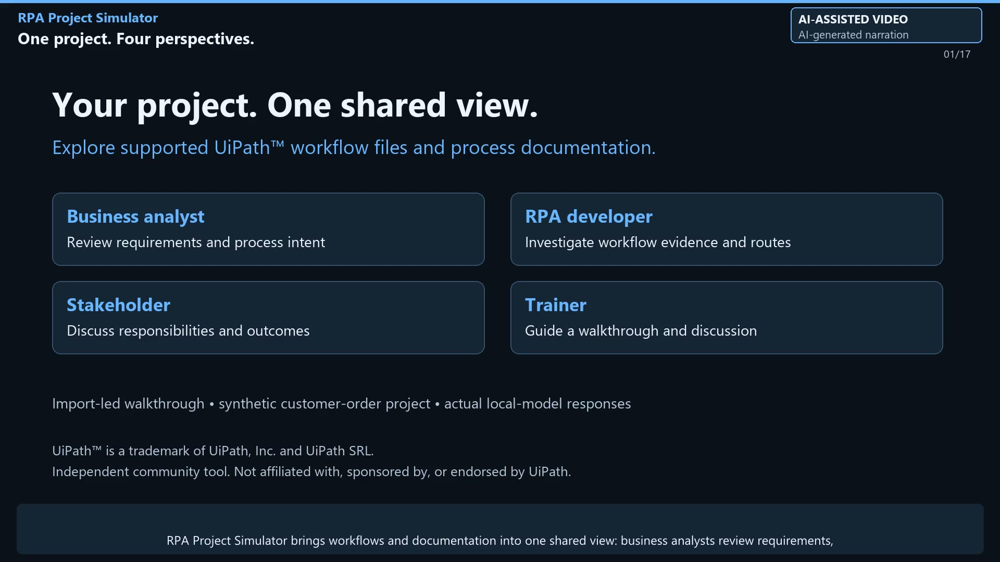

# RPA Project Simulator

An independent, dependency-free browser tool for exploring supported UiPath™ project files and process design documents (PDDs). Import supported workflow structures to build a review model, investigate documentation gaps and ask a local AI assistant about the supplied material. It does not execute UiPath workflows or certify project compatibility.

**v0.63:** the app uses the neutral name RPA Project Simulator. The repository and Pages URLs below are intentionally retained by the author; see the [branding and publication decisions](docs/BRANDING.md). No GitHub rename or remote change has been made.

The application is a single static page: no build, server, or account is required.

[**Open the live app**](https://dragos-cloud.github.io/uipath-rpa-project-simulator/) · [Watch the walkthrough](https://github.com/Dragos-cloud/uipath-rpa-project-simulator/releases/tag/v0.63)

An independent community tool developed by Dragos Marin. It is not affiliated with, sponsored by, or endorsed by UiPath.

## Trademark notice

UiPath™ is a trademark of UiPath, Inc. and UiPath SRL. References identify supported source formats and interoperability only; RPA Project Simulator is not an official UiPath product.

This notice does not claim permission, approval or certification. It is not a substitute for any permission required for a particular use. See [UiPath's Trademark & Copyright Use Policy](https://www.uipath.com/assets/downloads/trademark-copyright-use-policy). The MIT license covers this project's code, not rights to third-party trademarks.

## Watch the walkthrough (3:28)

[Watch or download the 3:28 video](https://github.com/Dragos-cloud/uipath-rpa-project-simulator/releases/download/v0.63/rpa-project-simulator-walkthrough-v063.mp4) · [English subtitles](https://github.com/Dragos-cloud/uipath-rpa-project-simulator/releases/download/v0.63/captions.srt) · [Walkthrough guide](docs/demo/README.md)

The demo presents a shared view for business analysts, RPA developers, stakeholders and trainers. It imports a synthetic Customer Order Processing project, distinguishes **Scenario** from **Inject Exception**, reviews PDD-to-code evidence, and uses actual local-model briefings, explanations and questions. Its intentionally unfinished code illustrates review questions, not a restriction on the app's audience. Inspectors stay in app context, controls are highlighted, and the PDD/code comparison has dedicated reading time. Built-in processes appear at the end as training examples. The video has AI-generated narration and a persistent AI disclosure; it does not show runtime execution or prove implementation completeness.

The [historical v0.61 walkthrough](https://github.com/Dragos-cloud/uipath-rpa-project-simulator/releases/tag/v0.61) is preserved unchanged with its former branding.

## Who it is for

| Role | Use it to |
| --- | --- |
| Business analyst (BA) | Compare documented requirements with the imported workflows, review gaps, clarify human work, and prepare a PDD draft. |
| RPA developer | Inspect workflow relationships, activity details, and inferred exception paths with the wider delivery team. |
| Stakeholder | Understand the process, discuss responsibilities and exceptions, and ask questions in business language. |
| Trainer | Build a walkthrough from project material, step through the flow, and use explanations and questions in a workshop. |

## Run it

Open the [live GitHub Pages app](https://dragos-cloud.github.io/uipath-rpa-project-simulator/) in a current desktop browser. No installation or GitHub account is needed.

For a local/offline copy, download or clone the repository and open [index.html](index.html). The optional AI tools still require a separately configured model endpoint.

This repository publishes automatically through GitHub Pages from the `main` branch, repository root (`/`). The `.nojekyll` file serves the existing static app without Jekyll processing. To host your own fork, enable **Settings → Pages → Deploy from a branch → main → / (root)**. Future pushes to that branch update the site; validation runs separately in GitHub Actions.

The public site does not host a shared LLM or run imported UiPath workflows. A `localhost` LM Studio endpoint refers to the visitor's own computer; connection depends on their server, CORS configuration and browser access policy. Use a local copy if the browser blocks that connection.

## Start with your project

1. Select **Import project…** and choose the project folder or its workflows and `project.json`.
2. Add a PDD (`.json` or `.docx`) and BPMN diagram if available. A PDD is optional.
3. Review any mapping suggestions, build the model, and inspect the steps, sources, and reported gaps.
4. Walk through the simulation and exception paths. Optionally connect LM Studio for **Brief me**, **Explain**, **Ask**, and imported-project **Plain names**.
5. Save the session or export the diagram, timeline, reports, and a PDD draft for review.

The invoice and onboarding samples are starter examples for learning the controls. They do not define the scope of the application. Imported models describe what the parser can infer; they do not execute the UiPath project or replace runtime testing.

## What it does

- Imports UiPath `.xaml`, `.cs`, `project.json`, PDD (`.json` or `.docx`), and BPMN files in the browser.
- Simulates happy paths, retries, recovery, terminal failures, human gates, and branching scenarios.
- Surfaces mappings, documentation differences and limited implementation evidence for human review—not a complete defect audit.
- Exports process models, diagrams, timelines, gap reports, and generated PDD drafts.
- Optionally connects to a user-configured OpenAI-compatible local endpoint, such as LM Studio, for explanations and briefing text.
- Includes generic invoice-processing and employee-onboarding samples for trying the controls.

## Privacy and data handling

The simulator processes imported files in the browser. It does not use a hosted backend. If you enable the LLM feature, the app sends only the context needed for that prompt to the endpoint you configure. Use a local endpoint for sensitive process material, and do not enable **Remember this token** on shared browser profiles.

This repository intentionally ignores imported workflows, PDDs, BPMN files, generated session exports, and Word documents. Commit only anonymised fixtures that you have permission to publish.

## Repository layout

- [index.html](index.html) — complete application (HTML, CSS, JavaScript, and generic samples).
- [PRODUCT_HANDBOOK.md](PRODUCT_HANDBOOK.md) — detailed product and maintenance reference.
- [CHANGELOG.md](CHANGELOG.md) — public release notes.
- [docs/BRANDING.md](docs/BRANDING.md) — neutral naming, trademark notices, retained repository URLs and video publication decisions.
- [docs/demo/README.md](docs/demo/README.md) — video, chapter guide, source-check limitations and a matching LinkedIn post draft. The MP4 and captions are attached to the GitHub release rather than stored in Git history.

## Quality checks

Run `node --test tests/pdd-parser.test.cjs tests/scenarios.test.cjs tests/guide.test.cjs tests/branding.test.cjs` for dependency-free parser, scenario, guide-navigation and branding regression tests. The GitHub Actions workflow runs these tests and verifies that the embedded JavaScript compiles. Before releasing, also check both sample processes, human gates, exception recovery, session save/load, document exports and the English/Romanian guide tabs in your target browsers. Test project imports with anonymised fixtures only.

## PDD structure support

Word imports support legacy English/Romanian step-and-exception tables and lane-oriented tables such as `# / BPMN element / Element type / Description`. Columns are resolved by their names rather than fixed positions. Current-state sections and grouped summaries are kept out of the target step list; gateways and events retain their types.

The **PDD readout** in mapping and the gap report shows what was extracted and which tables were not normalised. Exception state transitions are separate from exception definitions. Business rules, human-review requirements, open constraints and source references are retained. Human task requirements are not inserted as assumed executable gates, and missing Throw evidence does not prove that branch/status-based exception handling is absent.

Mapping works with REFramework `Process.xaml` calls and non-REFramework entry-workflow calls. Suggestions still need human confirmation. This is structured extraction, not universal understanding of arbitrary prose, embedded diagrams or every Word template. Existing JSON PDD imports remain supported.

## Limitations

Scenario titles identify the activity a route focuses on. **Branch details…** explains supported Boolean assumptions and retains the complete source expression and True/Then or False/Else outcome. These explanations do not need an LLM and do not evaluate runtime data. Unsupported expressions are flagged for technical review; older sessions with truncated expressions need a project re-import to recover the source. AI labels cannot change the selected branch or the source-based explanation.

Simulation timings are estimates, not production benchmarks. Imported models and PDD mappings need human review; coded workflows and unsupported control-flow constructs may not be fully represented. Imported persistence activities and human waits are not fully modelled: a BOT label or zero human-wait total does not prove a process has no manual work. AI explanations and generated documents are drafts and can contain mistakes, including overstating what unfinished code implements. Check them against the original sources. See the handbook for the detailed limitations.

## License

Licensed under the [MIT License](LICENSE). Redistributions must retain the copyright and permission notice for Dragos Marin.
