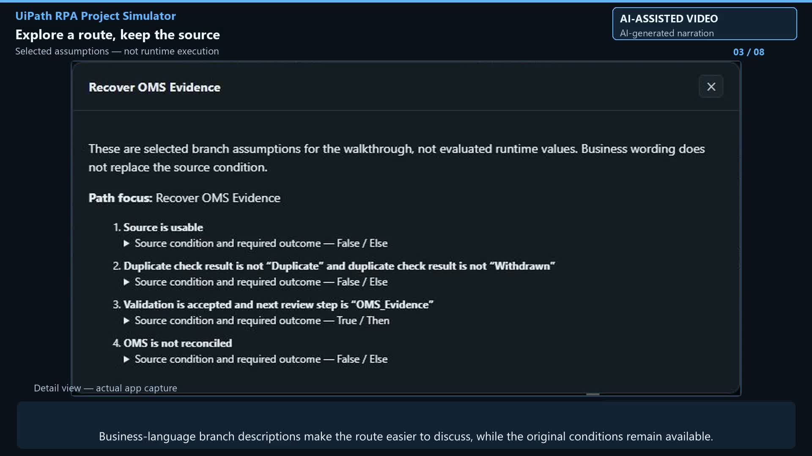

# Import your project — video walkthrough

[Open the live app](https://dragos-cloud.github.io/uipath-rpa-project-simulator/) · [Source repository](https://github.com/Dragos-cloud/uipath-rpa-project-simulator)

[Watch or download the MP4 (2:46, 1080p)](https://github.com/Dragos-cloud/uipath-rpa-project-simulator/releases/download/v0.61/uipath-rpa-project-simulator-demo.mp4) · [English subtitles](https://github.com/Dragos-cloud/uipath-rpa-project-simulator/releases/download/v0.61/captions.srt) · [Release](https://github.com/Dragos-cloud/uipath-rpa-project-simulator/releases/tag/v0.61)

Bring your own UiPath project into a shared view for business analysts, RPA developers, stakeholders and trainers. The video uses a synthetic Customer Order Processing PDD and intentionally unfinished workflows—not production data. The project is kept incomplete to support a discussion about what still needs work; its source files are not part of this repository.

## Chapters

| Start | What is shown |
| --- | --- |
| 0:00 | Your project, one shared view |
| 0:19 | Import workflows and the PDD; review mapping suggestions |
| 0:36 | Select Recover OMS Evidence; read business-language assumptions and original conditions |
| 0:58 | Compare documented intent with implementation evidence |
| 1:20 | Connect LM Studio and request a stakeholder briefing |
| 1:42 | Explain an activity, ask about human OMS responsibility, and check the sources |
| 2:11 | Step through the model, save a session, and explore exports and a PDD draft |
| 2:28 | Predefined examples as training material; bring your own project |

## What the demonstration does—and does not—establish

- Screens show actual app captures and actual `gemma-3-12b-it` responses through a locally configured LM Studio endpoint. The walkthrough is an edited sequence of narrated screen captures, not execution of the imported UiPath project.
- The PDD requires one business day; the sample's current clarification workflow uses `DateTime.Now.AddDays(1)`. This is a manually checked review example, not an automatically detected calendar-rule defect.
- The local AI can overstate functionality. In this capture, Explain suggests a full order-field comparison, while the WIP code checks evidence fields and the intake reference. The edit explicitly calls out this difference. Ask's answer also needs checking against the workflow arguments.
- A gap count or absence of matching Throw evidence does not establish a defect total. Mappings and AI answers require human review.
- Durations are estimates. Imported persistence/human-wait semantics are incomplete; a zero human-wait total or BOT label does not establish that manual responsibilities are automated.
- The PDD output is a draft for correction, not approved process documentation.

## Production disclosure

The video has AI-generated narration using ElevenLabs and AI-assisted production, with a persistent on-screen disclosure and embedded English captions. The final narration does not include an author credit; the app's existing footer may be visible. The optional SRT has approximate speech timing. The release asset is a fast-start H.264/AAC MP4, 1920×1080 at 24 fps, approximately 9.9 MB.

The MP4 and subtitles live in the GitHub release to avoid putting large binary production assets in Git history. Previous video cuts, voice files, credentials, raw model responses and private code-review notes are not published.

See the [LinkedIn post draft](LINKEDIN_POST.md). Publishing the repository or release does not post anything to LinkedIn.

Independent community tool developed by Dragos Marin; not affiliated with or endorsed by UiPath.
